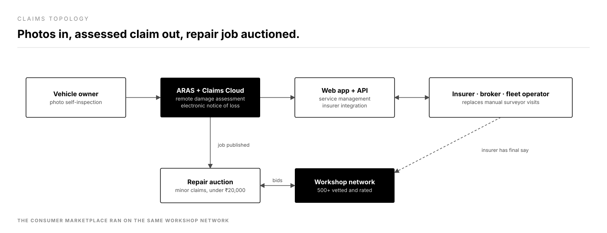
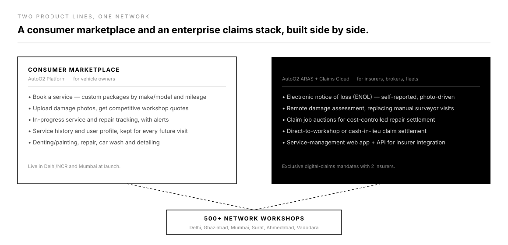
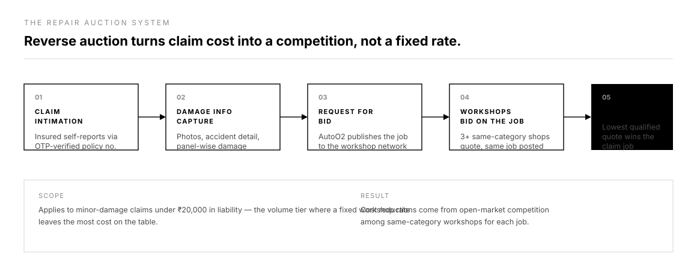

# AutoO2 — motor insurance claims SaaS

*A B2B claims platform I co-founded, built, and took to 500+ workshops.*

**Role:** Co-founder & chief product officer · **Company:** AutoO2 (Carmenta Solutions) · **Timeline:** June 2015 – April 2018

## 1. System context & business scale

AutoO2 (operated as Carmenta Solutions Private Limited) was my founding stint before the corporate roles. I co-founded it, served as CPO, and conceptualised, designed, built, and launched the product line myself. The vision: a connected digital post-sales vehicle care technology enterprise that serves vehicle owners and the B2B insurance ecosystem around them.

The business ran two product lines side by side:

- **A consumer marketplace.** The AutoO2 Platform let vehicle owners book servicing, denting and painting, and car care, with photo-based quotes and real-time job tracking.
- **An enterprise claims stack.** AutoO2 ARAS and AutoO2 Claims Cloud went to motor insurers, brokers, and fleet operators as a remote damage assessment and electronic-notice-of-loss (ENOL) system. It replaced manual surveyor visits with self-reported, photo-driven claims.

It reached 500+ network workshops across six cities within eight months of launch. AutoO2 was recognised among the top 8 most promising startups.

## 2. Architecture & integration topology

*Figure 1 — a vehicle owner submits photos, ARAS and Claims Cloud assess the damage, and the insurer receives the claim through the web app or API. Minor claims go to a reverse auction among network workshops.*

*Figure 2 — the consumer marketplace and the enterprise claims stack ran side by side, converging on the same 500+ workshop network.*

Claims Cloud grew into an enterprise suite with two surfaces: a claims web app for service management, and an API that lets insurers integrate AutoO2 into their own claims systems. The two product lines sold to different buyers. The marketplace competed on convenience for a vehicle owner. The claims stack competed on cost and turnaround for an insurer's claims team. Both depended on one asset, a vetted and rated network of repair workshops, so building that network was a product responsibility.

## 3. Key product & technical tradeoffs

- **Photo self-inspection vs. surveyor visits.** The claims model moved inspection to the vehicle owner. It cut surveyor dependency and claims cost.
- **Reverse auction vs. a fixed rate card.** For minor-damage claims (under ₹20,000), AutoO2 published the job to same-category workshops and let them bid. Competition set the price. The insurer kept final say over which workshop got the job.
- **Web app plus API.** Claims Cloud shipped a web app for service management and an API for insurers to integrate AutoO2 into their own claims systems.
- **Two product lines on one network.** The marketplace and the claims stack both drew on the same workshop network (Figure 2).

*Figure 3 — the reverse-auction mechanism behind claim job cost control.*

<!-- TODO(Aakash): add the pivot story (marketplace vs. enterprise focus) and the build-vs-buy calls on photo damage assessment. -->

## 4. Execution scope

- **AutoO2 ARAS,** the core claims SaaS for insurers: remote damage capture, claim assessment, and settlement workflows.
- **AutoO2 Claims Cloud,** the self-inspection workflow engine for motor and own-damage claims, with its web app and API.
- **The repair auction system.**
- **The workshop network,** recruited, onboarded, and rated by me: 500+ workshops, so insurers had a vetted panel and fleet operators had guaranteed service coverage.
- **AutoO2 Service Marketplace,** which added four vehicle maintenance services alongside digital claims support.

As founder and CPO I owned product, positioning to insurers and brokers, and the workshop network.

<!-- TODO(Aakash): founding team size and engineering headcount. -->

## 5. Impact & telemetry

- 500+ network workshops across Delhi, Ghaziabad, Mumbai, Surat, Ahmedabad, and Vadodara within eight months of launch.
- $100,000+ raised in pre-seed capital from angels and CXOs.
- Exclusive digital claims mandates from two insurance companies for touchless claim servicing.
- An equity-free grant of ₹10,00,000 from Mumbai Fintech, a Government of Maharashtra initiative, in its second grants cohort.

<!-- TODO(Aakash): claim turnaround time and cost per claim, self-inspection vs. surveyor visit. -->
<!-- TODO(Aakash): claims processed, GMV through the repair auction, and average auction saving. -->
