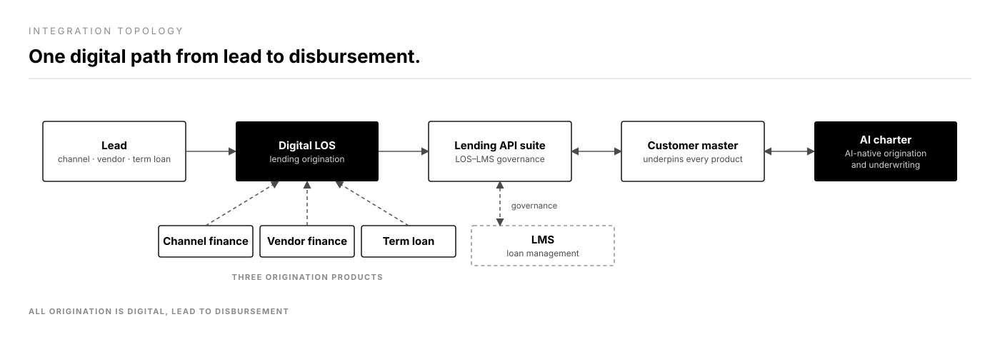

# JSW One Finance — lending origination platform

*Commercial lending, 100% digital, lead to disbursement.*

**Role:** SPM (AI) · **Company:** JSW One Finance (JOFL) · **Timeline:** November 2024 – present

## 1. System context & business scale

JOFL is a digital-first NBFC and a wholly owned subsidiary of JSW One Platforms. It exists to serve the credit needs of India's MSME ecosystem. I lead the lending origination (LOS), CRM, and AI charter as the second senior hire into the product team, and I own the operating model for how the team builds as well as the roadmap for what it builds.

- Three origination products run on the platform: channel finance, vendor finance, and term loans.
- Commercial lending is 100% digital, lead to disbursement.
- The business has grown 4x in AUM since FY25.

## 2. Architecture & integration topology

*Figure 1 — a lead enters the digital LOS, which runs on the lending API suite. The customer master and the AI charter sit on the same suite.*

The lending API suite sits between the LOS and the rest of the stack, and LOS–LMS governance runs across it. The customer master underpins every lending product. The AI charter works alongside it.

<!-- TODO(Aakash): confirm which origination and underwriting steps the AI charter automates today, and which systems sit outside this diagram (bureau, KYC, e-sign, payments). -->

## 3. Key product & technical tradeoffs

- **One customer master under every product.** Channel finance, vendor finance, and term loans all sit on the same customer master.
- **A governed API suite across LOS and LMS.** The lending API suite and LOS–LMS governance define how origination and loan management connect.
- **Spec before build.** The team runs 2.6 plan passes for every build pass, the inverse of typical AI-assisted coding. It trades early speed for output that lands without a rewrite.
- **Human checkpoints between build waves.** A person reviews the diff at each gate. It trades full autonomy for control over what ships.
- **Deterministic rules vs. AI-native steps.** The AI charter covers the AI-native lending products the team is building.

<!-- TODO(Aakash): add the build-vs-buy call for the LOS core, the assisted vs. straight-through split by product, and the rule vs. AI boundary for credit decisions. -->

## 4. Execution scope

I own channel finance, vendor finance, and term loan origination, the lending API suite and LOS–LMS governance, the customer master, and the AI initiatives. I also designed and run a governed, multi-agent AI development harness, built on Claude Code, as the team's operating model for shipping feature work.

The harness works in five stages:

1. **Spec before build.** Every feature starts as a discovery-and-spec pass.
2. **Bounded execution.** Workers run pre-flight checks and operate inside fixed file lanes. A worker cannot leave its assigned scope or guess at data mappings.
3. **Human checkpoints between build waves.** Nothing moves to the next wave unreviewed.
4. **Mandatory security review before ship.** Every feature clears a security gate before it merges.
5. **Measured like a product.** Sprint accuracy, cost per session, cost per line, and cache efficiency get reviewed the way the team reviews any product KPI.

<!-- TODO(Aakash): team size and composition at JOFL; number of products and features shipped in production. -->

## 5. Impact & telemetry

- AUM up 4x since FY25.
- Over 131 days the harness ran 360+ AI-assisted sessions and shipped 560K+ lines of production code across the live LOS platform.
- Delivery accuracy rose from an unguided 82% to a sustained 90%+ band.
- Feature-to-fix commit ratio: 4.5:1.
- Context-cache efficiency: 94%+ across 17B+ tokens processed.
- Return on AI tooling spend: roughly 14.7x against API-equivalent compute cost.

<!-- TODO(Aakash): turnaround time from lead to disbursement, before and after digital origination. -->
<!-- TODO(Aakash): approval rate, default and delinquency rates by product. -->
<!-- TODO(Aakash): disbursement volume and number of active borrowers. -->
<!-- TODO(Aakash): lending API latency (p50 / p95) and availability. -->
