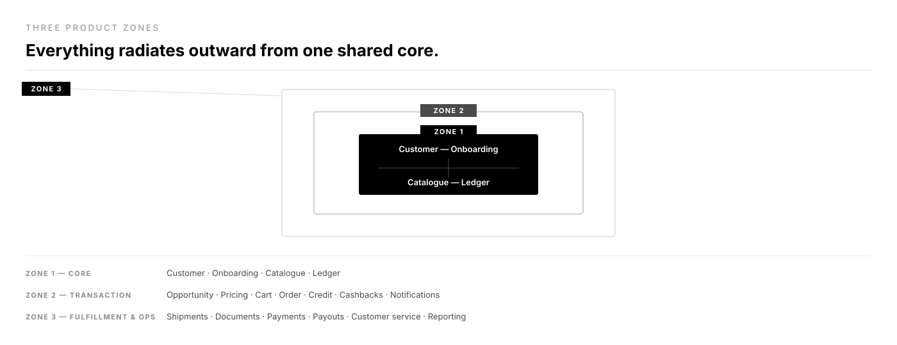
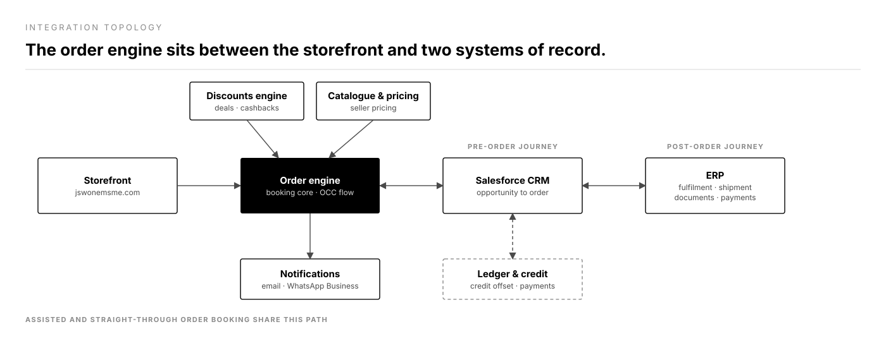
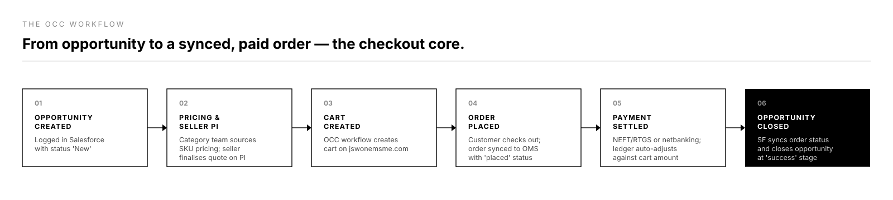

# JSW One MSME — B2B marketplace

*A credit-enabled marketplace for MSMEs to purchase industrial supplies.*

**Role:** SPM · **Company:** JSW One Platforms · **Timeline:** November 2021 – April 2024

## 1. System context & business scale

JSW One MSME (jswonemsme.com) is a B2B marketplace where MSMEs buy industrial supplies with embedded credit. I led product and strategy for the platform and personally designed the booking core, the order-creation journey that every order passes through.

- The platform grew to a $1B annualised GMV exit rate in FY '23–24.
- It runs on three zones: a stable core (customer, catalogue, ledger), a transaction layer built around Salesforce, and an outer layer for fulfilment and reporting.

*Figure 1 — the platform's three zones, from the shared core to fulfilment and reporting.*

## 2. Architecture & integration topology

*Figure 2 — the order engine connects the storefront to Salesforce CRM and ERP. The discounts engine and the catalogue and pricing system feed it. Notifications and the ledger hang off it.*

Two journeys run outward from the shared core. The pre-order journey runs through Salesforce up to order creation. The post-order journey runs through ERP from there to completion. The order-creation-and-checkout (OCC) flow holds most of the product decisions: opportunity conversion, seller pricing, ledger-based credit offset, and payment reconciliation, all before an order reaches ERP.

*Figure 3 — the high-level OCC (order creation and checkout) workflow, from opportunity to payment confirmation.*

Toggle between the two journeys below to see which building blocks each one touches.

<!--fd:jsw-stack-->

<!-- TODO(Aakash): confirm the integration style between the order engine, Salesforce, and ERP (sync API, queue, batch) and name the pricing system of record. -->

## 3. Key product & technical tradeoffs

- **Assisted and straight-through order booking.** I designed both flows on one booking core, so both pass through the same OCC flow.
- **Order creation in CRM before ERP.** An order starts as a Salesforce opportunity. Seller pricing, ledger-based credit offset, and payment reconciliation all complete before the order reaches ERP.
- **A discounts engine beside pricing.** Deals, discounts, and cashbacks run in their own engine, integrated with the catalogue and pricing system.
- **Integrate enterprise systems, own the booking core.** The booking core integrates deeply with Salesforce CRM and ERP and owns the order-creation journey between them.

<!-- TODO(Aakash): add the build-vs-buy reasoning for the discounts engine and any alternatives rejected (for example, a single-system order flow). -->

## 4. Execution scope

I supervised a team of 10+ UX/UI designers and frontend/backend engineers. The team shipped 35+ features and enhancements across the purchase funnel:

- Direct plant ordering
- Automated order confirmation
- Customer notifications
- Marketing automation
- Deals and discounts, including the discounts and cashbacks engine
- Shipment tracking
- WhatsApp Business integration

I also built the internal technical documentation repository, ran company-wide demos and PM training, and introduced the frameworks the team used for complex multi-product features.

## 5. Impact & telemetry

- $1B annualised GMV exit rate in FY '23–24.
- 35+ funnel features and enhancements shipped by a team of 10+.

<!-- TODO(Aakash): order-booking turnaround time, before and after the booking core. -->
<!-- TODO(Aakash): share of orders booked straight-through vs. assisted. -->
<!-- TODO(Aakash): funnel conversion lift from the 35+ enhancements; repeat-order rate; credit utilisation. -->
