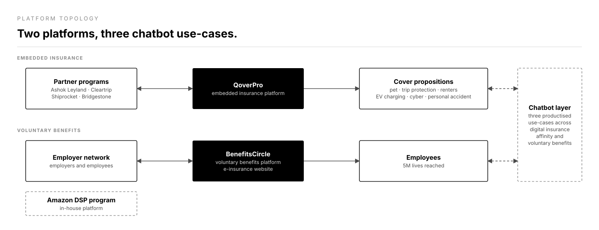

# Marsh — BenefitsCircle & QoverPro

*Voluntary employee benefits and embedded insurance, shipped for household names.*

**Role:** Lead product manager · **Company:** Marsh · **Timeline:** November 2019 – November 2021

## 1. System context & business scale

I was lead product manager and roadmap owner for two Marsh platforms. BenefitsCircle delivers voluntary employee benefits, and it reaches 5M lives across the employer-employee network. QoverPro is Marsh's embedded insurance platform. Together they powered programs for Amazon, Ashok Leyland, Cleartrip, Bridgestone, and Shiprocket.

## 2. Architecture & integration topology

*Figure 1 — partner programs reach customers through QoverPro, and employers reach employees through BenefitsCircle. Three productised chatbot use-cases span both.*

I owned the platform stack and the UI/UX of BenefitsCircle's customer-facing e-insurance website. QoverPro carried the partner programs:

- Ashok Leyland
- Cleartrip (EzCancel)
- Shiprocket (Secure Shipment)
- Bridgestone (BridgeCare)
- Amazon (Amazon DSP)

<!-- TODO(Aakash): confirm which platform (QoverPro or BenefitsCircle) carried each of the five programs, especially Amazon DSP; add the integration pattern with partners and the insurer-side systems. -->

## 3. Key product & technical tradeoffs

- **Embedded cover vs. a standalone insurance site.** QoverPro sells cover inside the partner's own product, such as EzCancel in Cleartrip and Secure Shipment in Shiprocket. BenefitsCircle sells through a customer-facing e-insurance website.
- **One platform stack, many programs.** Five large client programs ran on the platform stack I owned.
- **Chatbots as product.** I productised three chatbot use-cases across digital insurance affinity and voluntary benefits.

<!-- TODO(Aakash): add the build-vs-buy call on the chatbot stack and the configuration limits of QoverPro per client. -->

## 4. Execution scope

- Lead product manager and roadmap owner for BenefitsCircle and QoverPro.
- Product lead on the five partner programs above.
- Client-facing tech propositions for embedded pet insurance, trip protection, renters insurance, EV charging station insurance, cyber insurance, and personal accident cover.
- Selected into Marsh Asia's first cohort of 30 Digital Influencers, helping define the region's digital culture.

<!-- TODO(Aakash): team size supervised and number of programs launched to production. -->

## 5. Impact & telemetry

- BenefitsCircle reached 5M lives across the employer-employee network.
- Five named partner programs live on QoverPro.

<!-- TODO(Aakash): premium / GWP written through the embedded programs. -->
<!-- TODO(Aakash): attach rate and conversion for EzCancel, Secure Shipment, BridgeCare, and Amazon DSP. -->
<!-- TODO(Aakash): chatbot containment or deflection rate. -->
